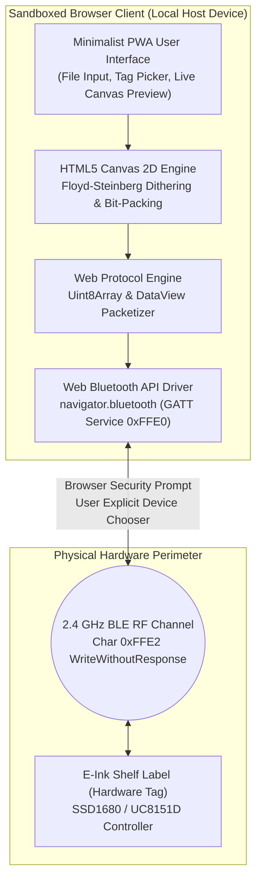

# Web-Based E-Ink Management Application: Architectural Plan & Security Remediation

**Target System:** Browser-Based Bluetooth Low Energy (Web Bluetooth) Electronic Shelf Label (ESL) Flasher  
**Protocol Compatibility:** 2.13", 2.9", 4.2" Dual-Color & Tri-Color Displays (Opcodes `0x13`, `0x12`, `0x50`)  
**Specification Reference:** [PROTOCOL_README.md](PROTOCOL_README.md) & [SECURITY_AUDIT.md](SECURITY_AUDIT.md)  
**Author:** Reverse Engineering & Systems Security Review  

---

## 1. Executive Concept & Architecture

Transitioning from an over-privileged Android APK (`lanqianzhushou_1.2.8.apk`) to a **Progressive Web Application (PWA)** utilizing the **Web Bluetooth API** (`navigator.bluetooth`) fundamentally alters the trust model.

Instead of running an unvetted native Android runtime containing suspicious permissions (`CALL_PHONE`, `INSTALL_PACKAGES`) and closed-source DCloud engine wrappers, the system operates as a **100% client-side, sandbox-constrained web application**. All image rendering, Floyd-Steinberg dithering, protocol serialization, and GATT packet streaming occur locally inside the browser engine (V8 / Chromium).

---

## 2. Comprehensive Pros & Cons Analysis

### Advantages (Pros)

1. **Complete Elimination of Dangerous Android Permissions (100% Resolved):**
   - Web applications have **zero access** to contacts, telephony (`CALL_PHONE`), system settings, or package installation (`INSTALL_PACKAGES`).
   - The browser sandbox strictly isolates the app from local OS facilities.
2. **Zero Cloud Telemetry & 100% Air-Gapped / Offline Capable:**
   - The application does not require any remote server backend. It can be hosted on GitHub Pages or run locally off `file://` or `localhost`.
   - Complete removal of hardcoded third-party analytics and endpoints (`api.youzixy.com`).
3. **Cross-Platform Compatibility Without Compiling:**
   - Operates identically on Chrome/Edge on Windows 10/11, macOS, Linux, ChromeOS, and Android Chrome.
   - Zero installation friction: users navigate to a URL and pair their tags directly without sideloading unknown APKs.
4. **Open, Auditable Source Code:**
   - No encrypted DEX wrappers (`assets/39285EFA.dex`) or obfuscated bytecodes.
   - Every packet construction routine (`Uint8Array`) and pixel dithering step is fully inspectable in DevTools.
5. **Enforced Security Standards by Modern Browsers:**
   - Web Bluetooth **strictly requires HTTPS** (or `localhost`), preventing man-in-the-middle code injection.
   - Web Bluetooth **strictly requires an explicit User Gesture** (`click` event) to open the native OS device chooser, preventing silent background scanning or unauthorized pairing.

---

### Disadvantages & Limitations (Cons)

1. **Browser Engine Support Fragmentation:**
   - **Supported:** Google Chrome, Microsoft Edge, Opera, Samsung Internet (Desktop & Android).
   - **Unsupported:**
     - **iOS Safari:** Apple does not support the Web Bluetooth API due to privacy/fingerprinting concerns (requires dedicated third-party Web Bluetooth browsers such as *Bluefy*).
     - **Mozilla Firefox:** Disabled by default due to fingerprinting and security concerns.
2. **Firmware-Level RF Vulnerabilities Remain Unchanged:**
   - Web Bluetooth secures the *host client*, but it cannot fix the physical tag's lack of onboard authentication. An attacker within physical RF range can still transmit packets directly to the tag using custom hardware unless the tag's firmware itself is reflashed.
3. **BLE MTU & Transmission Throughput Constraints:**
   - Web Bluetooth relies on the operating system's native BLE stack (WinRT on Windows, BlueZ on Linux, Android Bluetooth).
   - The web app must conservatively throttle packet dispatch (e.g., 20ms delays between 19-byte packets) to avoid dropping `WriteWithoutResponse` frames on hardware tags with small receive buffers.

---

## 3. Security Vulnerability Remediation Matrix

This table maps the findings from [SECURITY_AUDIT.md](SECURITY_AUDIT.md) to the Web App architectural remediation:

| Audit ID | Vulnerability in Original APK | Web App Resolution Status | Technical Remediation Mechanism |
| :--- | :--- | :--- | :--- |
| **SEC-01** | Zero BLE Authentication / Encryption | **Partially Mitigated on Host** | • Host-side: Browser forces explicit user pairing chooser (no invisible scanning). • RF-side: Hardware tags remain open unless tag firmware is upgraded. |
| **SEC-02** | Weak 8-Bit Checksum & Replay Risk | **Preserved for HW Compatibility** | • The web engine computes the required 8-bit checksum for tag compatibility. • Eliminates client-side credential/state storage where replay attacks could be staged. |
| **SEC-03** | Android Permission Over-Privilege | **100% FIXED** | Browser sandbox replaces native OS permissions. App has **zero** permission to read contacts, make calls, or install apps. |
| **SEC-04** | Cleartext HTTP & Hardcoded Endpoints | **100% FIXED** | Web app operates offline via Service Worker. Requires HTTPS. Completely severs all ties with `https://api.youzixy.com`. |
| **SEC-05** | Exported Android Activities Exposure | **100% FIXED** | No Android Activities, Intents, or IPC Binder surfaces exist. |
| **SEC-06** | Screen Burn-In via Repeated Writes | **Mitigated in Client Logic** | Web UI enforces software rate-limiting (e.g., minimum 5-second lockout between refresh cycles) and preview validation before transmission. |

---

## 4. Technical Implementation & Verification Status

The web application is implemented and verified with a clean modular ES architecture across [index.html](index.html), [app.js](app.js), [ble.js](ble.js), [dither.js](dither.js), and [protocol.js](protocol.js).

### Phase 1: Web Bluetooth Communication Driver — [VERIFIED COMPLETE]
- Device discovery using `navigator.bluetooth.requestDevice` with prefixes `EDP` and `WP`.
- Declared GATT services: `0xFFE0` (driver), `0x180F` (standard battery), `0x180A` (device info).
- Auto-detected device architecture:
  - Modern devices: Reads battery percentage from standard characteristic `0x2A19` (service `0x180F`).
  - Legacy devices: Subscribes to notifications on `0xFFE1` and sends battery query `[0x60, 0x00, 0x01, 0x00, 0x61]` to `0xFFE2`.
- Sequential packet pacing with configurable delays (default 50ms) to prevent tag radio buffer overruns.

### Phase 2: Graphic Engine, 3-Color Dithering & Layer Separation — [VERIFIED COMPLETE]
- Offscreen master image cache (`rawSourceCanvasElement`) to allow lossless re-dithering across modes without re-uploading.
- Scaled and centered image rendering matching all hardware profiles (defaulting to 2.13" $250 \times 128$).
- Implemented 3-color Floyd-Steinberg error diffusion matching `lanqianzhushou_1.2.8.apk` (`EPaperPicture.java` palette 6: White `[255,255,255]`, Black `[0,0,0]`, Red `[255,0,0]`).
- Strict dual-plane bit packing:
  - **Black Plane (`0x13`):** Black pixels $= 0$, White and Red pixels $= 1$.
  - **Red Plane (`0x12`):** Red pixels $= 1$, Black and White pixels $= 0$.

### Phase 3: Protocol Framing & Flash Sequencing — [VERIFIED COMPLETE]
- Header start frame `13 00 00 00 00` (and `12 00 00 00 00` for red plane).
- 16-byte chunked payload streaming with 1-byte sequence counter and modular 8-bit checksum.
- Footer finish frame `13 FF FF FF FF` (and `12 FF FF FF FF`).
- Refresh execution command `50 00 01 01` with post-transmission latch delay.

### Phase 4: UI & Diagnostic Tooling — [VERIFIED COMPLETE]
- **Display Surface Layer Previews:**
  - `Composite Preview`: Simulated e-paper rendering showing white, black, and red pixels together.
  - `Black Layer (0x13)`: Isolates black plane; transparent non-black pixels rendered over a subtle chassis checkerboard.
  - `Red Layer (0x12)`: Isolates red plane; transparent non-red pixels rendered over a subtle chassis checkerboard.
- **Pixel Telemetry Stats Bar:** Live counts and percentages for White, Black, and Red pixels.
- **Diagnostic Hex Console:** Collapsible direct transmission console with quick command tooltips for manual tag testing.
- **Offline PWA:** Fully offline-capable via [sw.js](sw.js) and [manifest.json](manifest.json).
