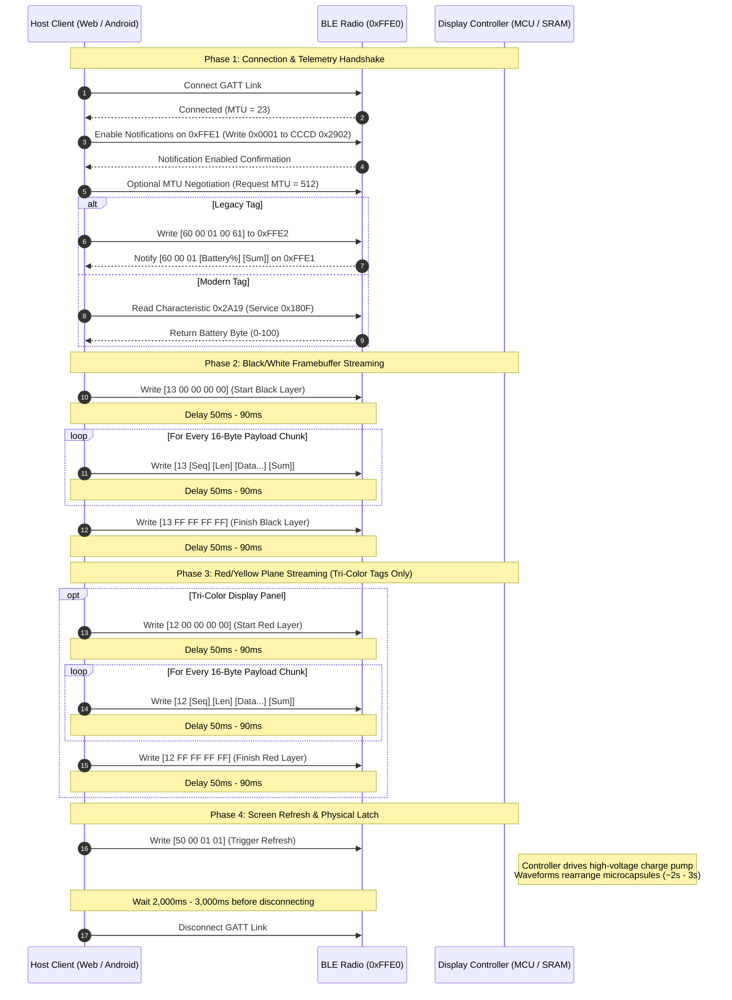

# E-Ink Electronic Shelf Label (ESL) - Complete BLE Command Specification

**Target Protocol:** Lanqianzhushou / ZGHD Pinntag E-Paper Bluetooth Low Energy Protocol  
**Extracted From:** `lanqianzhushou_1.2.8.apk` (`io.dcloud.uniplugin.photoUtil`)  
**Hardware Platforms:** 2.13", 2.90", 3.70", 4.20", 7.50" Dual-Color & Tri-Color Electronic Paper Displays (EPD)  
**Document Purpose:** Exhaustive engineering reference for all Bluetooth Low Energy (BLE) commands, packet framing structures, telemetry notifications, and timing requirements.

---

## 1. Bluetooth GATT Architecture & UUIDs

The electronic shelf tags operate as GATT Servers. Communication is performed over either the **Vendor-Specific Service (`0xFFE0`)** or the **Standard Battery Service (`0x180F`)**.

### Primary Radio Service & Characteristics
| UUID | Handle / Short | Type | Properties | Description |
| :--- | :--- | :--- | :--- | :--- |
| `0000ffe0-0000-1000-8000-00805f9b34fb` | `0xFFE0` | Primary Service | — | Main E-Ink display driver communication service. |
| `0000ffe1-0000-1000-8000-00805f9b34fb` | `0xFFE1` | Characteristic | `READ`, `NOTIFY` | Telemetry & asynchronous command response channel (e.g., battery levels). |
| `0000ffe2-0000-1000-8000-00805f9b34fb` | `0xFFE2` | Characteristic | `WRITE`, `WRITE_NO_RESPONSE` | Primary command & image bitstream transmission sink. |

### Auxiliary Telemetry Service (Modern / "New Device" Revision)
| UUID | Handle / Short | Type | Properties | Description |
| :--- | :--- | :--- | :--- | :--- |
| `0000180f-0000-1000-8000-00805f9b34fb` | `0x180F` | Primary Service | — | Standard Bluetooth SIG Battery Service. |
| `00002a19-0000-1000-8000-00805f9b34fb` | `0x2A19` | Characteristic | `READ`, `NOTIFY` | Returns single-byte battery percentage value (`0`–`100`). |

### Alternative DCloud / Telink Module Service UUID
| UUID | Short | Description |
| :--- | :--- | :--- |
| `BE940000-7333-BE46-B7AE-689E71722BD5` | Primary Service | Alternative vendor service used on some Telink firmware revisions. |
| `BE940001-7333-BE46-B7AE-689E71722BD5` | Characteristic | Alternative notification channel. |
| `BE940002-7333-BE46-B7AE-689E71722BD5` | Characteristic | Alternative write channel. |

---

## 2. Complete Command Catalog

All commands are written directly to Characteristic `0xFFE2` (or `BE940002`).

### Command Summary Table

| Opcode | Hex Representation | Byte Count | Direction | Purpose |
| :--- | :--- | :--- | :--- | :--- |
| **`0x60`** | `60 00 01 00 61` | 5 Bytes | Host $\to$ Tag | **Query Battery Percentage (Legacy Tag)** |
| **`0x60`** | `60 00 01 [Level] [Sum]` | 5 Bytes | Tag $\to$ Host | **Battery Level Notification Response (on `0xFFE1`)** |
| **`0x13`** | `13 00 00 00 00` | 5 Bytes | Host $\to$ Tag | **Start Black/White Framebuffer Transmission** |
| **`0x13`** | `13 [Seq] [Len] [Data...] [Sum]` | Variable | Host $\to$ Tag | **Black/White Image Data Chunk (Small Panel, 1-byte Seq)** |
| **`0x13`** | `13 [SeqHi] [SeqLo] [Len] [Data...] [Sum]` | Variable | Host $\to$ Tag | **Black/White Image Data Chunk (Large Panel, 2-byte Seq)** |
| **`0x13`** | `13 FF FF FF FF` | 5 Bytes | Host $\to$ Tag | **Finish Black/White Framebuffer Transmission** |
| **`0x12`** | `12 00 00 00 00` | 5 Bytes | Host $\to$ Tag | **Start Red/Yellow Framebuffer Transmission** |
| **`0x12`** | `12 [Seq] [Len] [Data...] [Sum]` | Variable | Host $\to$ Tag | **Red/Yellow Image Data Chunk (Small Panel, 1-byte Seq)** |
| **`0x12`** | `12 [SeqHi] [SeqLo] [Len] [Data...] [Sum]` | Variable | Host $\to$ Tag | **Red/Yellow Image Data Chunk (Large Panel, 2-byte Seq)** |
| **`0x12`** | `12 FF FF FF FF` | 5 Bytes | Host $\to$ Tag | **Finish Red/Yellow Framebuffer Transmission** |
| **`0x50`** | `50 00 01 01` | 4 Bytes | Host $\to$ Tag | **Execute Screen Refresh Cycle (`Ble.updateSend`)** |
| **`0x50`** | `50 01 00 51` | 4 Bytes | Host $\to$ Tag | **Alternative Screen Refresh (Standalone Firmware Variant)** |

---

## 3. Detailed Command Packet Structures

### 3.1. Query Battery Percentage (`0x60`)

Used by the mobile app to verify connectivity and obtain the remaining cell voltage percentage before writing to flash memory.

#### Request Frame (Host $\to$ Tag on `0xFFE2`):
```
Offset:   0x00  0x01  0x02  0x03  0x04
Bytes:   [ 60    00    01    00    61  ]
```
- `0x00`: Opcode `0x60` (Battery Query).
- `0x01`: Reserved `0x00`.
- `0x02`: Parameter Length `0x01`.
- `0x03`: Query Type `0x00`.
- `0x04`: Modular 8-bit Checksum `0x61` ($0x60 + 0x00 + 0x01 + 0x00 = 0x61$).

#### Response Frame (Tag $\to$ Host Notification on `0xFFE1`):
```
Offset:   0x00  0x01  0x02  0x03          0x04
Bytes:   [ 60    00    01   [BatteryLevel] [Checksum] ]
```
- `0x00..0x02`: Header preamble `60 00 01`.
- `0x03`: Battery level integer ($0$ to $100$ percent).
- `0x04`: Checksum $(0x60 + 0x00 + 0x01 + \text{BatteryLevel}) \pmod{256}$.

---

### 3.2. Start Color Plane Transmission (`0x13` / `0x12`)

Resets the internal SRAM pointer in the tag's display controller.

#### Start Black/White Plane:
```
Hex: 13 00 00 00 00
```
- `0x13`: Layer Identifier (Black/White plane).
- `0x00 00 00 00`: Reset address pointer delimiter.
- **Polarity:** Bit `0` = Black particle energized; Bit `1` = White / Inactive particle.

#### Start Red/Yellow Plane:
```
Hex: 12 00 00 00 00
```
- `0x12`: Layer Identifier (Red/Yellow chromatic plane).
- `0x00 00 00 00`: Reset address pointer delimiter.
- **Polarity:** Bit `1` = Red particle energized; Bit `0` = Inactive / Transparent to red plane.

---

### 3.3. Paged Image Data Chunks

Image pixels are packed at 1 bit per pixel (8 pixels per byte, MSB first) in **column-major order**. Data is sliced into chunks and formatted depending on display size.

#### Small Display Panels (2.13", 2.90" — Single-Byte Sequence Counter):
Used when total packet count is $\le 255$.
```
+-----------+---------------+---------------+-----------------------+---------------+
| Byte 0    | Byte 1        | Byte 2        | Bytes 3 .. (N+2)      | Byte (N+3)    |
+-----------+---------------+---------------+-----------------------+---------------+
| Opcode    | Sequence No.  | Chunk Length  | Payload Data Bytes    | Sum Checksum  |
| 0x13/0x12 | 0x01 .. 0xFF  | N (e.g. 16)   | Packed 1-bit pixels   | sum(Data)%256 |
+-----------+---------------+---------------+-----------------------+---------------+
```
- **Total Packet Size:** $\text{ChunkLength} + 4$ bytes (e.g., $16 + 4 = 20$ bytes, fitting inside default 23-byte MTU).

#### Large Display Panels (3.70", 4.20", 7.50" — Two-Byte Sequence Counter):
Used when total packet count exceeds 255.
```
+-----------+---------------+---------------+---------------+-----------------------+---------------+
| Byte 0    | Byte 1        | Byte 2        | Byte 3        | Bytes 4 .. (N+3)      | Byte (N+4)    |
+-----------+---------------+---------------+---------------+-----------------------+---------------+
| Opcode    | Seq High Byte | Seq Low Byte  | Chunk Length  | Payload Data Bytes    | Sum Checksum  |
| 0x13/0x12 | (Seq >> 8)    | (Seq & 0xFF)  | N (e.g. 16)   | Packed 1-bit pixels   | sum(Data)%256 |
+-----------+---------------+---------------+---------------+-----------------------+---------------+
```
- **Total Packet Size:** $\text{ChunkLength} + 5$ bytes (e.g., $16 + 5 = 21$ bytes).

---

### 3.4. Finish Color Plane Transmission (`0x13` / `0x12`)

Commits the SRAM buffer in the display driver and closes the current color plane write transaction.

#### Finish Black/White Plane:
```
Hex: 13 FF FF FF FF
```

#### Finish Red/Yellow Plane:
```
Hex: 12 FF FF FF FF
```

---

### 3.5. Execute Screen Refresh Cycle (`0x50`)

Energizes the electrophoretic particles by running the pre-programmed Look-Up Table (LUT) waveform sequence inside the display controller.

#### Standard Update Command (`Ble.updateSend()`):
```
Hex: 50 00 01 01
```
- `0x50`: Opcode `0x50` (Refresh / E-Paper Driver Control).
- `0x00`: Reserved.
- `0x01`: Trigger parameter count.
- `0x01`: Full-screen refresh trigger flag.

#### Alternative Firmware Refresh Variant:
```
Hex: 50 01 00 51
```
- `0x50`: Opcode.
- `0x01`: Mode flag.
- `0x00`: Reserved.
- `0x51`: Modular Checksum ($0x50 + 0x01 + 0x00 = 0x51$).

---

## 4. Hardware Panel Profiles & Resolution Matrix

| Panel Size | Resolution ($W \times H$) | Counter Mode | 90° Clockwise Rotate | Total 1-Bit Buffer Size | Typical Packet Count (16B chunks) | Profile Status |
| :--- | :--- | :--- | :--- | :--- | :--- | :--- |
| **2.13" (B)** | $250 \times 128$ | 1-Byte Sequence | No | 4,000 Bytes | ~252 Packets | **Primary Hardware Default** |
| **2.13" (A)** | $250 \times 122$ | 1-Byte Sequence | No | 3,813 Bytes | ~240 Packets | Legacy 2.13" |
| **2.90"** | $296 \times 128$ | 1-Byte Sequence | No | 4,736 Bytes | ~298 Packets | Standard |
| **3.70"** | $416 \times 240$ | 2-Byte Sequence | No | 12,480 Bytes | ~782 Packets | Extended |
| **4.20"** | $400 \times 300$ | 2-Byte Sequence | **Yes (Rotated)** | 15,000 Bytes | ~940 Packets | Standard |
| **7.50"** | $800 \times 480$ | 2-Byte Sequence | **Yes (Rotated)** | 48,000 Bytes | ~3,002 Packets | Large Panel |

---

## 5. End-to-End Transmission Protocol State Machine

To successfully flash a tag without it ignoring commands or dropping frames, the host client must follow this strict sequence:



---

## 6. Critical Implementation Gotchas & Debugging Checklist

If a connected tag is not responding to battery queries, flashes, or refresh commands:

1. **Mandatory Notification Enablement (CCCD `0x2902` on `0xFFE1`):**
   In the original `TestModule.java`, `PhotoTask` is **never executed until `onNotifySuccess` fires on `0xFFE1`**. Many CC2541/Telink microcontrollers do not exit low-power sleep mode or accept commands on `0xFFE2` until the host writes `0x0001` to the Client Characteristic Configuration Descriptor (CCCD) of `0xFFE1`.
2. **Pacing / Inter-Packet Delays:**
   The Android application explicitly enforces:
   ```java
   SystemClock.sleep(TestModule.sendInterval); // 90ms for legacy tags, 50ms for new tags
   ```
   Streaming packets with $< 30\text{ms}$ delays will overflow the tag's radio buffer and cause silent packet drops.
3. **`Write With Response` vs `Write Without Response`:**
   The Android `BleManager` library uses `WRITE_TYPE_DEFAULT` (write with response / acknowledged write) for all commands and waits for the callback before sending the next frame. If the host client issues `writeWithoutResponse` when the peripheral GATT table only exposes `WRITE`, the OS Bluetooth stack will silently drop or reject the write.
4. **Service Scope in Web Bluetooth:**
   The browser will reject access to `0x180F` (Battery) or `0xFFE1` (Notify) unless declared inside `optionalServices`:
   ```javascript
   optionalServices: [
     "0000ffe0-0000-1000-8000-00805f9b34fb",
     "0000180f-0000-1000-8000-00805f9b34fb",
     "0000180a-0000-1000-8000-00805f9b34fb"
   ]
   ```
5. **Post-Refresh Latch Delay:**
   After issuing Opcode `0x50`, the client **must maintain the BLE connection for at least 2,000ms** to allow the charge pump to initialize before disconnecting.
6. **Diagnostic Console Quick Command Mapping:**
   When testing or bypassing higher-level canvas pipelines, the following raw hex strings can be dispatched directly to `0xFFE2`:
   - `60 00 01 00 61` : Query Battery (Legacy tag response on `0xFFE1`)
   - `13 00 00 00 00` : Allocate Black/White buffer
   - `13 FF FF FF FF` : Commit & close Black/White buffer
   - `12 00 00 00 00` : Allocate Red/Yellow buffer
   - `12 FF FF FF FF` : Commit & close Red/Yellow buffer
   - `50 00 01 01` : Trigger panel LUT waveforms / charge pump refresh
   - `50 01 00 51` : Alternate firmware refresh trigger
