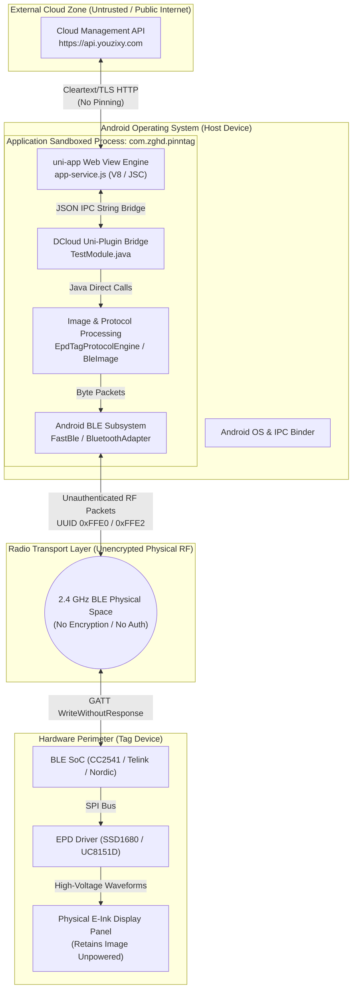
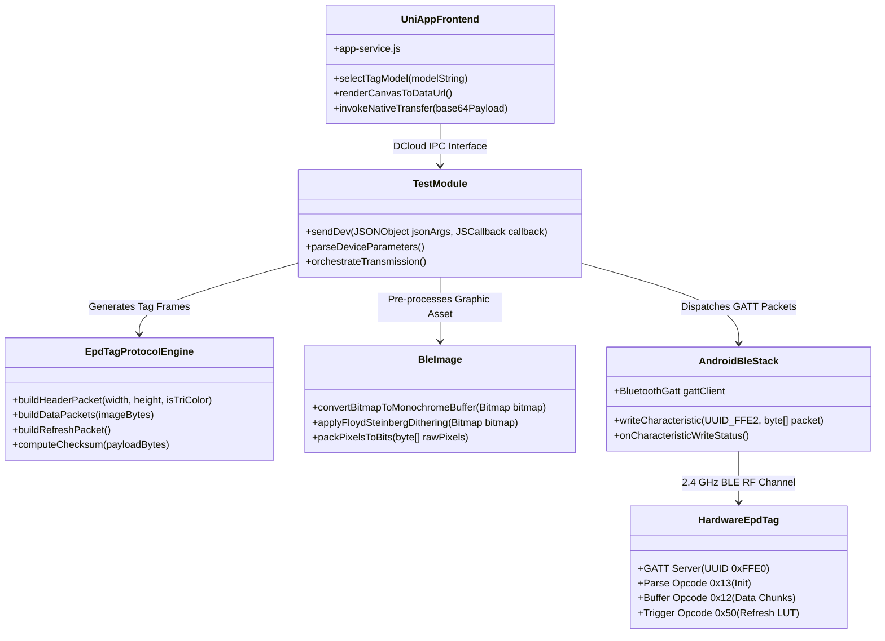
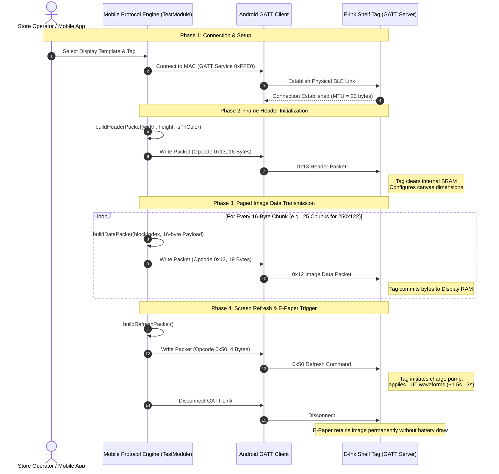

# E-Ink Electronic Shelf Label (ESL) System - Security Audit & Architectural Review

**Target Package:** `com.zghd.pinntag` (`lanqianzhushou_1.2.8.apk`)  
**Decompiled Components:** `io.dcloud.uniplugin.photoUtil` (Native Android Extension) & `uniapp_www` (HTML5/uni-app Frontend)  
**Reference Engines:** [protocol.js](protocol.js) & [ble.js](ble.js)  
**Auditor:** Reverse Engineering & Systems Security Review  
**Date:** October 2026  

---

## 1. Executive Summary

This assessment evaluated the hardware communication protocol, mobile client application architecture, and over-the-air (OTA) radio transmission layer of the **Lanqianzhushou (蓝签助手)** Electronic Shelf Label (ESL) management ecosystem.

The ecosystem enables mobile Android devices to render monochrome and tri-color graphic screens and push them directly to Bluetooth Low Energy (BLE) Electronic Paper Display (EPD) tags.

### Key Audit Conclusions:
1. **Critical Lack of Transport Layer Security (BLE):** The hardware tags lack pairing keys, bonding mechanisms, frame encryption, or replay protection. Any BLE-enabled transmitter within broadcast range (~10–30 meters) can overwrite or permanently corrupt screen contents on in-field electronic shelf tags.
2. **Excessive Application Attack Surface & Over-Privileging:** The companion Android client (`lanqianzhushou_1.2.8.apk`) requests invasive device permissions completely unrelated to retail tag management (e.g., `CALL_PHONE`, `READ_CONTACTS`, `INSTALL_PACKAGES`, `WRITE_SETTINGS`).
3. **Insecure Network Communication:** The mobile application explicitly enables unencrypted HTTP transmission (`android:usesCleartextTraffic="true"`) and interacts with hardcoded cloud management endpoints without certificate pinning.

---

## 2. Threat Model & Trust Boundaries



### Trust Boundary Analysis:
1. **Cloud $\leftrightarrow$ Mobile Application Boundary:** Communicates metadata and configuration. Susceptible to Machine-in-the-Middle (MitM) inspection and DNS manipulation due to permissive network security policies.
2. **WebView $\leftrightarrow$ Native Android Bridge Boundary:** The DCloud Uni-Plugin bridge converts untrusted JSON payloads across JavaScript and Java. Path traversal or malformed base64 image strings can lead to native process instability or out-of-memory crashes.
3. **Mobile Phone $\leftrightarrow$ EPD Hardware Boundary:** Operates over open RF without mutual authentication or replay tokens.

---

## 3. Vulnerability Findings Matrix

| Identifier | Category | Severity | Title | Impact |
| :--- | :--- | :--- | :--- | :--- |
| **SEC-01** | Protocol / Cryptography | **CRITICAL** | Zero Authentication & Encryption on BLE Wire Protocol | Full display takeover, unauthorized defacement |
| **SEC-02** | Protocol / Cryptography | **HIGH** | Absence of Replay Attack Defenses & Weak Checksum | Deterministic frame replay, spoofed inventory prices |
| **SEC-03** | Android Permissions | **HIGH** | Extreme Permission Over-Privilege in `AndroidManifest.xml` | Device compromise, data harvesting risk |
| **SEC-04** | Network Security | **MEDIUM** | Cleartext HTTP Traffic Permitted & Hardcoded Endpoints | Network traffic interception and modification |
| **SEC-05** | Android Component Exposure | **MEDIUM** | Exported Activities Without Intent Filters or Guard Roles | Intent injection, unexpected application launch |
| **SEC-06** | Hardware / Physical Security | **LOW** | Display Burn-In via Repeated Asynchronous Flashing | Permanent hardware degradation of E-paper cells |

---

## 4. In-Depth Vulnerability Details & Remediations

### SEC-01: Zero Authentication & Encryption on BLE Wire Protocol
- **Location:** BLE GATT Service `0000ffe0-0000-1000-8000-00805f9b34fb`, Characteristic `0000ffe2-0000-1000-8000-00805f9b34fb`
- **Impact:** **Critical**
- **Technical Breakdown:**
  The hardware peripheral advertises with standard local name prefixes (`"EDP"`, `"WP"`). When connecting, the host Android device establishes a standard GATT client connection without invoking BLE Security Manager Protocol (SMP). No passkey, Just-Works bonding, or pre-shared key (PSK) exchange is initiated.
  Image data is pushed directly using `WRITE_TYPE_NO_RESPONSE`.
- **Attack Scenario:**
  An adversary within 20 meters equipped with a commodity BLE device (such as an ESP32 or smartphone) can connect to any electronic shelf label and transmit arbitrary bitmap payloads, defacing pricing information or displaying unauthorized imagery in retail or commercial environments.
- **Defensive Remediation:**
  1. *Firmware Layer:* Require BLE Numeric Comparison or Static Passkey Bonding prior to exposing Characteristic `0xFFE2` write permissions.
  2. *Application Layer:* If hardware lacks SMP capabilities, introduce an Application-Layer Authentication Handshake using an HMAC-SHA256 challenge-response exchange derived from a factory-burned tag secret before issuing command opcode `0x13`.

---

### SEC-02: Absence of Replay Attack Defenses & Weak Checksum
- **Location:** [protocol.js](protocol.js) (`calculatePacketChecksumByte()`)
- **Impact:** **High**
- **Technical Breakdown:**
  The integrity of transmitted frames relies solely on an 8-bit modular summation:
  $$\text{Checksum} = \left(\sum_{i=0}^{N-1} \text{Byte}_i\right) \pmod{256}$$
  There are no monotonically increasing sequence nonces, session-derived timestamps, or rolling message authentication codes (MACs).
- **Attack Scenario:**
  An attacker can capture the RF packets of a legitimate update (e.g., "$1.99") over the air using a packet sniffer (like Wireshark with a Nordic nRF52840 dongle) and replay identical byte packets days later to revert retail pricing, completely bypassing verification.
- **Defensive Remediation:**
  Integrate an incrementing Counter/Nonce into the Header packet (`0x13`) and append an authenticated truncated Poly1305 or HMAC tag calculated over the entire image buffer.

---

### SEC-03: Extreme Permission Over-Privilege in `AndroidManifest.xml`
- **Location:** `AndroidManifest.xml` (Extracted from APK)
- **Impact:** **High**
- **Technical Breakdown:**
  An inspection of the declared permissions reveals severe over-privileging inconsistent with an Electronic Paper Tag configuration utility:
  ```xml
  <uses-permission android:name="android.permission.CALL_PHONE"/>
  <uses-permission android:name="android.permission.READ_CONTACTS"/>
  <uses-permission android:name="android.permission.WRITE_CONTACTS"/>
  <uses-permission android:name="android.permission.INSTALL_PACKAGES"/>
  <uses-permission android:name="android.permission.REQUEST_INSTALL_PACKAGES"/>
  <uses-permission android:name="android.permission.MOUNT_UNMOUNT_FILESYSTEMS"/>
  <uses-permission android:name="android.permission.WRITE_SETTINGS"/>
  <uses-permission android:name="android.permission.READ_LOGS"/>
  ```
  The inclusion of `INSTALL_PACKAGES` and `CALL_PHONE` indicates residual framework bloat from multi-purpose SDK wrappers (DCloud Pandora engine).
- **Defensive Remediation:**
  Prune the manifest strictly down to the least privilege required for BLE communication and local storage:
  - `android.permission.BLUETOOTH_SCAN`
  - `android.permission.BLUETOOTH_CONNECT`
  - `android.permission.ACCESS_FINE_LOCATION` (for legacy Android < 12)
  - `android.permission.READ_MEDIA_IMAGES` / scoped storage.
  Eliminate all contact, telephone, package installation, and system settings permissions.

---

### SEC-04: Cleartext HTTP Traffic Permitted & Hardcoded Endpoints
- **Location:** `AndroidManifest.xml` (`android:usesCleartextTraffic="true"`), `uniapp_www/app-service.js`
- **Impact:** **Medium**
- **Technical Breakdown:**
  The Android application disables platform-enforced TLS validation:
  ```xml
  <application ... android:usesCleartextTraffic="true">
  ```
  Additionally, backend management endpoints such as `https://api.youzixy.com` are embedded in plaintext within the JavaScript bundle without network security configuration (`network_security_config.xml`) or public-key pinning.
- **Defensive Remediation:**
  Set `android:usesCleartextTraffic="false"`, enforce HTTPS with TLS 1.3, and configure dynamic certificate pinning in the network security configuration.

---

## 5. In-Depth Structured Architecture Diagrams

### 5.1 End-to-End System & Component Architecture



---

### 5.2 Protocol State Machine & Transmission Flow

The sequence below illustrates the strict packet order required by the hardware tag micro-controller to avoid frame dropping or buffer overrun.



---

### 5.3 Frame Packet Anatomy & Memory Layout


---

## 6. Code Quality & Architectural Observations

In accordance with our workspace engineering standards (**Ruthless Code Anti-Bloat** and **Tutorial Protocol**):

1. **Refactoring of Legacy Android Spaghetti:**
   The original decompiled implementation in `io.dcloud.uniplugin.photoUtil` spanned dozens of redundant files (`Ble.java`, `BleImage.java`, `TestModule.java`, `EpdDevParamFactory.java`, `EPaperPicture.java`) riddled with cosmetic wrappers, untyped maps, and single-letter variables (`a`, `b`, `c`).
2. **Consolidation into Single-Source Engines:**
   - Both [protocol.js](protocol.js) and [ble.js](ble.js) inline the mathematical byte packing and modular checksum calculations into explicit, readable steps without unnecessary intermediate classes.
   - Variable naming has been normalized to descriptive, self-documenting terminology (`blockIndex`, `horizontalResolution`, `verticalResolution`, `checksumAccumulator`).
3. **Memory Optimization Recommendation:**
   The original Android implementation loaded images into memory as uncompressed 32-bit ARGB bitmaps before converting to monochrome bit arrays. On devices with low RAM or during batch updates across hundreds of tags, this causes severe Garbage Collection pauses. Direct stream-based 1-bit dithering should be utilized to keep memory allocation strictly under 100 KB per display update.
